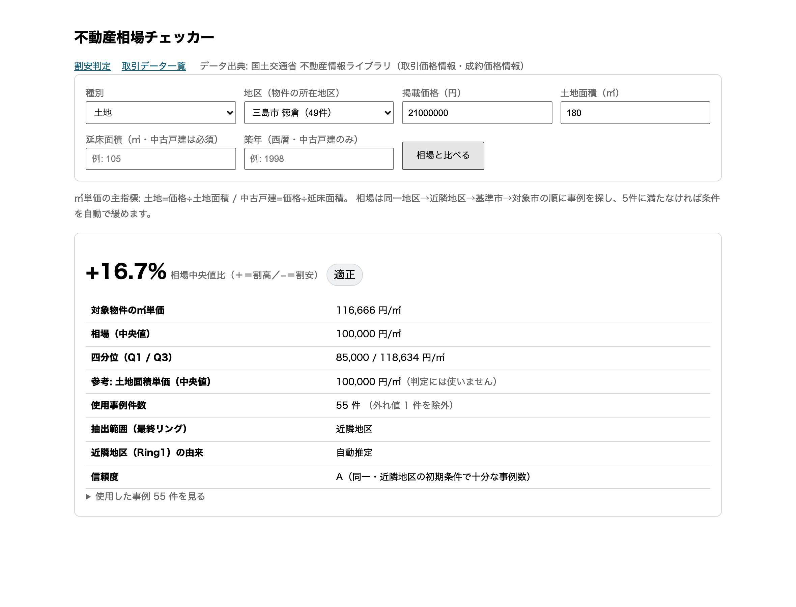

# 不動産相場チェッカー（fudosan-soba-checker）

指定エリアの実取引相場（㎡単価の分布）を国交省・不動産情報ライブラリ（reinfolib）公式APIから取得し、
購入検討物件の割安判定材料を提示するローカルツール。

- 設計と判定ロジックの根拠: [docs/design.md](docs/design.md)
- 状態: **動作する**（取込バッチ＋一覧＋判定。テスト72件）。土地・中古戸建・中古マンション（区分）の3種別に対応し、
  中古戸建は延床でも絞り、外れ値を統計的にトリムする
- 掲載サイト（SUUMO等）とは連携しない。掲載物件はブラウザで自分で見て、価格をこのツールに入力して比べる

> 個人利用のツールを公開用に整えたものです。設定値（対象エリア・APIキー）は `.env` で外から与える設計で、
> リポジトリには実際の対象エリアを含みません。テストのコードは実在しない自治体コード（`99001` 等）を使います。

## 画面

物件条件を入力すると、相場中央値比・3段バンド・信頼度・使用件数（外れ値の除外件数含む）・最終リング・Ring1 の由来をまとめて返す。



## セットアップ

```bash
python3 -m venv .venv
.venv/bin/pip install -r requirements.txt
```

`env.example` をコピーして `.env` を作る（`.env` は gitignore 済み。**キーをコードやリポジトリに書かない**）:

```bash
cp env.example .env
```


| 変数 | 必須 | 説明 |
|---|---|---|
| `REINFOLIB_API_KEY` | ✅ | reinfolib のAPIキー（下記「APIキー取得」） |
| `TARGET_CITIES` | ✅ | 取込対象の市区町村コード5桁をカンマ区切り。**先頭が基準市**（Ring2 の基準）。例: `13101,13102,13103` |
| `NEIGHBOR_DISTRICTS` | | Ring1（近隣地区）= 生活圏の地区コード9桁をカンマ区切り。未設定なら地価が近い同一市内の地区を自動推定（下記「判定の読み方」） |
| `HOME_DISTRICT` | | フォームで最初に選択される地区コード |
| `INGEST_YEARS` | | 取込ウィンドウ（既定 3 年 = 12四半期） |

地区コード（9桁 = 市区町村コード5桁 + 地区4桁）は、取込後に `/transactions` 画面のプルダウン、
または `GET /api/transactions` の `district_code` で確認できる。

## 使い方

```bash
# 1) 取込（四半期ごとの公開に合わせて手動実行。毎回ウィンドウ全取得 → 冪等 upsert）
.venv/bin/python -m app.workers.ingest              # TARGET_CITIES × 直近3年
.venv/bin/python -m app.workers.ingest --years 1    # ウィンドウを狭める
.venv/bin/python -m app.workers.ingest --city 13101 # 対象市を絞る

# 2) 起動
.venv/bin/python -m uvicorn app.main:app --reload --port 8811
```

- `http://127.0.0.1:8811/` … 物件条件を入力 → 相場比・バンド・信頼度を表示（HTMX）
- `http://127.0.0.1:8811/transactions` … 取込済みデータの一覧（地区・種別で絞り込み）
- `http://127.0.0.1:8811/docs` … OpenAPI（`/api/transactions`・`/api/valuate` の JSON API）

DB は `data/soba.db`（SQLite・gitignore 済み）。スキーマを変えたら削除して取込し直す。

## 判定の読み方

- **主表示 = 相場中央値比**（例 `−15.0%`）。`−` が割安、`+` が割高
- **補助 = 3段バンド**（同じ標本の四分位: Q1未満=割安 / Q1〜Q3=適正 / Q3超=割高）
  - 中央値比が `+` でもバンドが「適正」になることがある（ばらつきが大きい標本）。両方を見て判断する
- **㎡単価の定義**（API の `UnitPrice` は使わず自前計算）
  - 土地 = 価格 ÷ 土地面積
  - 中古戸建 = 価格 ÷ **延床面積**（延床が無いレコードは判定母集団から除外）
  - 中古マンション（区分） = 価格 ÷ **専有面積**（XIT001 の `Area` が専有面積。`TotalFloorArea` は
    実データで全件空なので延床では絞らない）
  - 従指標として **土地面積単価の中央値**（価格 ÷ 土地面積）も併記する。**判定には使わない参考値**
- **抽出範囲（リング）**: 同一地区 → 近隣地区 → 基準市全域 → 対象市全域
  - Ring1（近隣地区）は `NEIGHBOR_DISTRICTS` が最優先。未設定なら
    **同一市内で宅地(土地)㎡単価の中央値が対象地区の±25%以内（双方3件以上）** の地区を自動推定する
  - 結果に Ring1 の由来（手動設定 / 自動推定 / なし）を表示する
- **自動拡張**: 使える事例が5件未満のとき、種別ごとの順序で緩める
  - 土地: リング → 築年（±5→±10→撤廃）→ 土地面積（±30%→±50%）
  - 中古戸建: リング → 築年±10 → **延床±50%** → 築年撤廃 → 土地面積±50%
  - 中古マンション: リング → 築年（±5→±10→撤廃）→ 専有面積（±30%→±50%）。**延床の段は持たない**
  - 戸建は**延床でも絞る**（主指標が延床単価なので比べる軸と絞る軸を一致させる）。
    延床は ±50% が下限で**撤廃しない**（延床40㎡と180㎡が同じ母集団に入る壊れ方に戻さないため）。
    区分は `Area` 自体が専有面積なので、この一致が最初から成立している
- **外れ値トリム**: 標本が6件以上のとき、㎡単価が `[Q1−1.5×IQR, Q3+1.5×IQR]` の外にある事例を除外し、
  中央値・四分位を再計算する。「古家付き土地」相当の極端な単価でバンドが広がるのを防ぐ。
  **5件の閾値判定はトリム後の件数**で行い、除外件数は結果に必ず表示する
- **信頼度**: A（初期条件で5件以上）/ B（範囲や条件を広げて5件以上）/ C（3〜4件）/ 判定不能（0〜2件）
  - **ばらつきガード**: 最終標本の Q3/Q1 が 1.8 を超えるとき信頼度を1段下げ（A→B→C）、「ばらつき大」を表示する
- 結果には常に **使用件数・除外件数・最終リング・Ring1 の由来・緩めた条件** が付く

## テスト

```bash
.venv/bin/python -m pytest              # 単体＋統合（ネットワークに出ない）
.venv/bin/python scripts/smoke.py       # 起動中サーバの全エンドポイント 5xx チェック
```

## APIキー取得

https://www.reinfolib.mlit.go.jp/ の「API利用申請」から申請（無料・審査あり・メール登録）。
発行キーは `.env` の `REINFOLIB_API_KEY` に設定する。

## 構成

```
app/
  api/routes_soba.py    # HTMX画面 + JSON API
  services/
    reinfolib.py        # XIT001 client（1req/秒スロットル・指数バックオフ・正規化・内容ハッシュ）
    districts.py        # 地区リング解決と事例抽出（座標は使わない）
    valuation.py        # 判定の純粋ロジック（DB非依存）
    storage.py          # 冪等 upsert
  models/transaction.py # SQLAlchemy async
  workers/ingest.py     # 取込バッチ CLI
  templates/            # base / index / transactions / _result / _error
scripts/
  phase0_probe.py       # Phase 0 の実物確認プローブ（XPT001。記録用・現在は未使用）
  smoke.py              # エンドポイントのスモークテスト
tests/                  # pytest（ネットワークに出ない。自治体コードは実在しない 99001 等）
docs/design.md          # 設計の根拠（なぜこの作りなのか）
env.example             # .env のひな形
```

## Phase 0: 実物確認プローブ（記録）

```bash
REINFOLIB_API_KEY=<キー> HOME_LAT=<緯度> HOME_LNG=<経度> python3 scripts/phase0_probe.py
```

XPT001（タイル・座標）を検証した結果、座標が数km級のクラスタ点で近傍抽出に使えないと判明したため、
**XIT001（市区町村コード指定）＋地区リング方式**へ設計変更した（生データは `out/`・gitignore 済み）。

## 対象外（今回やらないこと）

SUUMO等のスクレイピング／レインズ連携／ヘドニック回帰・ML（Lv2以降）／ハザード・都市計画レイヤ／
新築・一棟物件／PostgreSQL・PostGIS 移行／認証・マルチユーザー。
